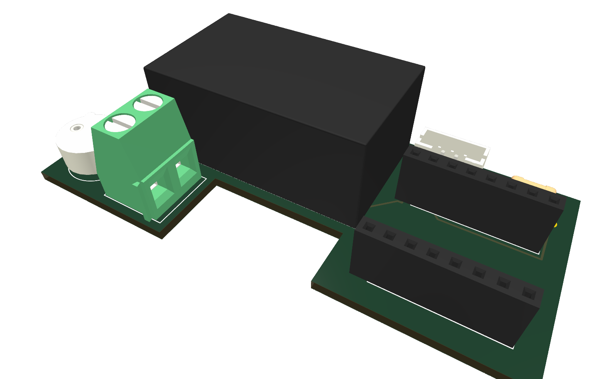
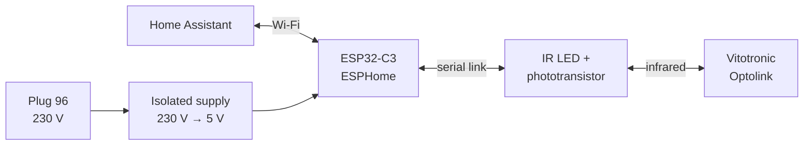
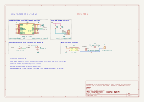
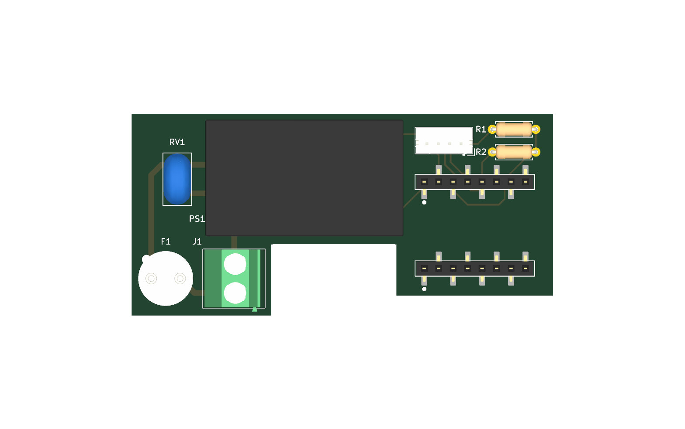
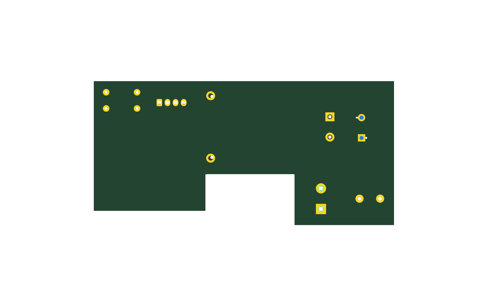

# viessmann-optolink-esphome

[Français](README.md) · **English**

Control your Viessmann boiler from Home Assistant, with a small Wi-Fi board that sits on its optical diagnostic port.



> [!NOTE]
> **Project status.** The firmware works on the boiler with a breadboard prototype. The board and the enclosure are final; their ESP32-C3 version is still to be validated on the boiler.
>
> **Ready-made boards.** I may have assembled boards in stock: open an issue if you want one.

## What it does

- **Monitor the boiler**: temperatures (boiler, hot water, outdoor, flue gas), burner (on/off, power, number of starts, operating hours), pumps, faults.
- **Control it from Home Assistant**:
  - room setpoints (normal and reduced) and hot water setpoint;
  - operating mode (off, hot water only, heating and hot water) and economy mode;
  - heating curve.
- **Safe**: if Home Assistant stops responding for 30 minutes, the boiler goes back to its own schedule.

## Compatibility

Tested on a **Vitodens 222-W** with a **Vitotronic 200 type HO1B** controller. Other Viessmann boilers with an Optolink port should work once the addresses in the configuration are adapted. The models are listed on the [OpenV wiki](https://github.com/openv/openv/wiki).

## How it works

Viessmann controllers have an optical port on the front, the Optolink, meant for diagnostic tools. An infrared LED and a phototransistor placed on it talk to the controller. An ESP32-C3 running ESPHome relays the exchange to Home Assistant over Wi-Fi. The board is powered from the boiler's 230 V accessory output.



## Credits

The project started from the ESPHome `optolink` component by [j0ta29](https://github.com/j0ta29) ([PR #4453](https://github.com/esphome/esphome/pull/4453), closed by its author in October 2026 without being merged into ESPHome). Its documentation page is no longer online. A copy from the [Web Archive](https://web.archive.org/web/20251012034933/https://deploy-preview-2737--esphome.netlify.app/components/optolink) is kept in `knowledge/viessmann-optolink-esphome.pdf`: it has the original infrared adapter schematic and its ESPHome configuration.

The firmware now uses [esphome_vitohome](https://github.com/SoulSolistice/esphome_vitohome) by SoulSolistice, a maintained ESPHome component that speaks the same protocol and was developed on the same controller.

This repository adds a dedicated board, with its 230 V supply, and an enclosure that mounts on the Optolink.

## Hardware

### 230 V supply

The board connects to **plug 96** of the Vitotronic, the 230 V output meant for accessories. It is switched by the boiler's switch: the board turns off with the boiler.

- **Isolated supply** HLK-PM01 (230 V → 5 V, 3 W): the low-voltage side is separated from the mains.
- **T1A time-lag fuse** in a holder, and a **varistor** against surges.
- **Screw terminal** for the L and N wires (0.75 mm² flexible, with ferrules).
- More than **6 mm** between 230 V and low voltage on the board.

> [!WARNING]
> This build involves the boiler's 230 V. Cut the power before any work, and never plug the C3's USB while the board is powered: its 5 V pin is tied straight to USB and would feed the computer. If in doubt, ask an electrician.

### Schematic



### Board

2-layer board, 74 × 35.5 mm, all through-hole parts. The C3 plugs into sockets and the infrared head connects through a JST lead: everything can be taken apart.

| Top | Bottom |
|---|---|
|  |  |

The KiCad 10 project is in `hardware/`, and can be browsed online with [KiCanvas](https://kicanvas.org/?github=https://github.com/Plokkke/viessmann-optolink-esphome/blob/main/hardware/heater-controller.kicad_sch).

### Enclosure

3D-printed in four parts: two half shells, a sliding lid and the plug that clips onto the Optolink. The files are in `enclosure/`: one STL per part, `print-setup.stl` with the four parts on the print bed, and the Fusion 360 source.

## Building the board

Two ways, with the same Gerber files:

- **Solder it yourself**: JLCPCB makes the board, LCSC supplies the parts.
- **Have JLCPCB assemble it**: it solders everything; you only clip in the fuse.

`hardware/scripts/export.sh` writes the Gerbers, the LCSC cart and the JLCPCB assembly files (BOM and CPL) to `hardware/fabrication/`. It needs KiCad 10.

**Cost** (quote from November 2026): for 5 boards, about $60 for JLCPCB manufacturing and assembly, plus about €15 of fuses and leads, sold in packs. Printing the enclosure is negligible (about €1 at a fablab). That makes **€14 to €17 per board**, but **about €70** for a single board if you do not already have the parts.

### Parts for one board

| Part | Qty | Reference | Unit price |
|---|---|---|---|
| Hi-Link HLK-PM01 power supply | 1 | LCSC C209903 | $2.74 |
| Littelfuse 56000001009 TR5 fuse holder | 1 | LCSC C142909 | $0.76 |
| Littelfuse 37211000001 TR5 T1A 250 V time-lag fuse | 1 | LCSC C142808, DigiKey WK4248CT-ND | $0.22 (LCSC), $1.24 (DigiKey) |
| Bourns MOV-07D431K varistor | 1 | LCSC C1528105 | $0.14 |
| Kefa KF128 2-way screw terminal, 5.08 mm pitch | 1 | LCSC C474952 | $0.19 |
| JST PH 4-pin header B4B-PH-K-S | 1 | LCSC C131334 | $0.05 |
| 1×8 female socket, 2.54 mm pitch, 8.5 mm high | 2 | LCSC C27438 | — |
| 220 Ω 1/4 W resistor | 1 | LCSC C57439 | — |
| 10 kΩ 1/4 W resistor | 1 | LCSC C57436 | — |
| ESP32-C3 super mini, with its male pins | 1 | AliExpress | — |
| 200 mm 4-wire JST PH lead (Adafruit 4045) | 1 | DigiKey 1528-2825-ND | $0.95 |
| Everlight SIR204C 3 mm infrared LED | 1 | DigiKey 1080-1171-ND | $0.64 |
| OSRAM SFH 309 FA 3 mm phototransistor | 1 | DigiKey 475-SFH309FA-ND | $0.55 |

Prices checked in October and November 2026, per unit or for small packs.

## Installation

1. **Flash the C3** over USB, off the board (see *Firmware*), then plug it into its sockets.
2. **Make the infrared head**: solder the LED and the phototransistor to the end of the JST lead, then press them into the holes of the enclosure plug. On J2:
   - pin 1: LED anode;
   - pin 2: LED cathode;
   - pin 3: phototransistor collector;
   - pin 4: phototransistor emitter.

   Do not trust the lead colours: find pin 1 on the connector.
3. **Wire the 230 V**, boiler off: the wires from plug 96 come in through the optical plug and screw into the terminal block (terminal 1: L, terminal 2: N).
4. **Close the enclosure** and clip it onto the Optolink, the LED facing the boiler's phototransistor (Optolink "V" mark).
5. **Switch the boiler back on**: the board shows up in Home Assistant.

To check that the LED emits, look at it through a phone camera.

## Firmware

The firmware is an ESPHome configuration, in `firmware/`.

```sh
uv tool install esphome
cp firmware/secrets.example.yaml firmware/secrets.yaml   # Wi-Fi, API key, OTA password
cd firmware
esphome run controlleur-chaudiere.yaml --device /dev/cu.usbmodemXXXX    # first flash, C3 on USB
esphome run controlleur-chaudiere.yaml --device controlleur-chaudiere.local   # updates over Wi-Fi
```

If the C3 does not show up over USB, plug it in while holding its `BOOT` button. `test-connectivity.yaml` replaces the boiler with fake entities, to test Wi-Fi and Home Assistant on the bench.

## In Home Assistant

The board shows up as the **Controlleur chaudière** device. The main entities:

| Entity | Use |
|---|---|
| Boiler Temperature, Hot water temperature, Outdoor temperature | temperatures |
| Burner, Burner power, Burner starts, Burner hours | burner state and use |
| Disturbance, Last error | current fault, last error with its date |
| Heating | thermostat: room setpoint and mode, as presets |
| Reduced room temperature setpoint | reduced room setpoint |
| Hot water setpoint | hot water setpoint |
| Operation mode, Economy mode | operating mode |
| Heating curve slope, Heating curve level | heating curve |

> [!IMPORTANT]
> The boiler keeps its setpoints and modes in EEPROM, which wears with every write. In your automations, only change a value when it really has to change: no more than once every 15 to 20 minutes, and never in a loop.

## Known limits

- **Third-party component**: the Optolink protocol is not part of ESPHome; it comes from [esphome_vitohome](https://github.com/SoulSolistice/esphome_vitohome), pinned to its `v0.6` release. To update it, change that tag in `firmware/controlleur-chaudiere.yaml` and rebuild.
- **One controller only**: another thermostat on the boiler (Tado, Vitotrol…) forces its own setpoint back. It has to be disconnected.
- **Wi-Fi**: the C3 super mini antenna is weak on many batches. Check the signal (*Wi-Fi signal* entity) in the boiler room.

## Going further

- [`knowledge/architecture.md`](knowledge/architecture.md): the board's role in the house, write rules, design choices (in French).
- [`knowledge/datapoints-optolink.md`](knowledge/datapoints-optolink.md): Optolink addresses of the Vitotronic 200 HO1B (in French).
- [`knowledge/pression-circuit-chauffage.md`](knowledge/pression-circuit-chauffage.md): heating circuit pressure (in French).
- `knowledge/manuals/`: Viessmann manuals.

## License

[MIT](LICENSE): the board, the enclosure and the firmware are free to copy, modify and sell.

---

**Keywords**: Viessmann Vitodens 222-W, Vitotronic 200 HO1B, gas boiler, Optolink, optical interface, IR adapter, Device ID `20CB`, P300 / VS2 protocol, OpenV, vcontrold, ESPHome, Home Assistant, home automation, ESP32-C3, ESP32-C3 super mini, HLK-PM01, KiCad PCB, JLCPCB, 3D-printed enclosure, Tado thermostat replacement.
