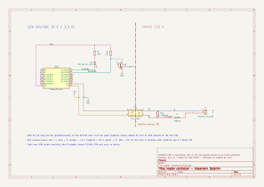
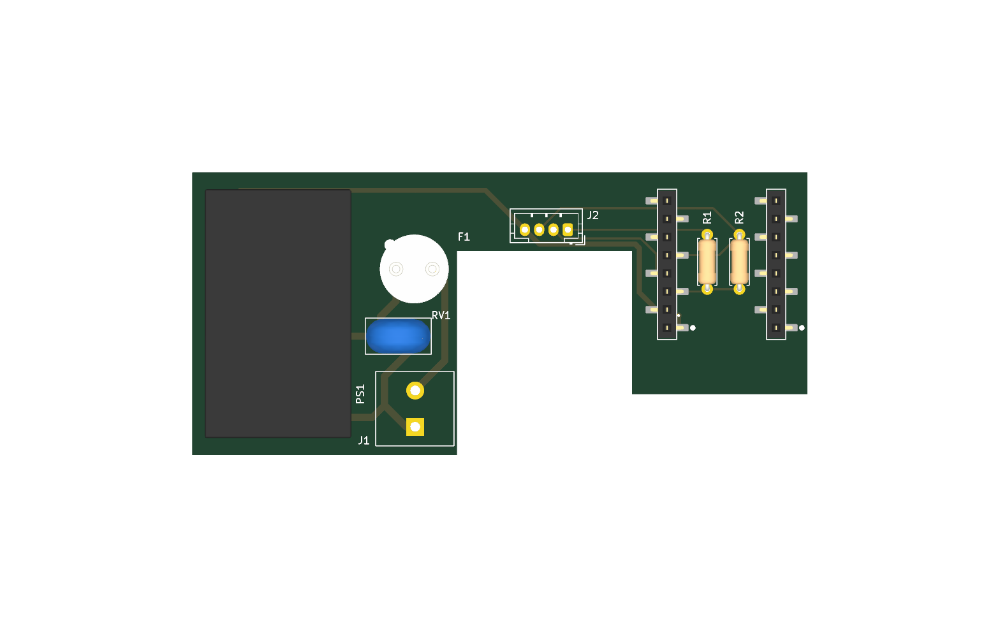
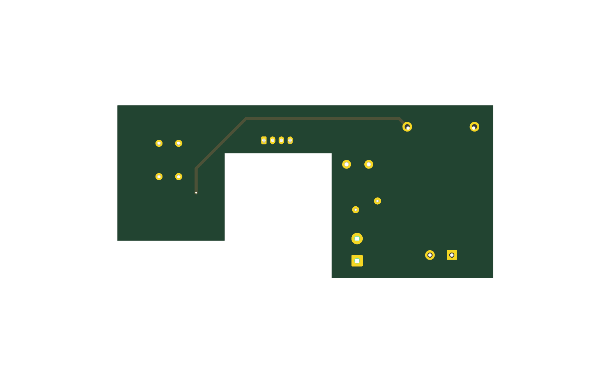

# viessmann-optolink-esphome

[Français](README.md) · **English**

DIY adapter that controls a Viessmann **Vitodens 222-W** gas boiler (wall-hung, built-in hot water tank; Vitotronic 200 controller type HO1B, Optolink Device ID `20CB`) from Home Assistant through its **Optolink** optical interface, reading and writing its *datapoints* (boiler temperature, room setpoint, operating mode, economy mode, fault).

ESPHome firmware on a Wemos D1 mini (ESP8266); `P300` protocol; `optolink` component from ESPHome PR [#4453](https://github.com/esphome/esphome/pull/4453).

> [!NOTE]
> **Project status.** The circuit (IR adapter on a breadboard) and the firmware **work on the boiler**: reading temperatures and writing the setpoint and mode are validated. The **dedicated PCB** (`hardware/`) and its **enclosure** are **not final**: the board has not been manufactured yet.

**Keywords**: Viessmann Vitodens 222-W, Vitotronic 200 HO1B, gas boiler, Optolink, optical interface, IR adapter, Device ID `20CB`, P300 / VS2 protocol, OpenV, vcontrold, ESPHome, Home Assistant, home automation, ESP8266, Wemos D1 mini, HLK-PM01, Tado thermostat replacement.

## Repository layout

| Folder | Content |
|---|---|
| `firmware/` | ESPHome configuration: `common.yaml` (Wi-Fi, API, OTA, LED, diagnostics), `controlleur-chaudiere.yaml` (Optolink), `test-connectivity.yaml` (fake entities), `secrets.example.yaml` |
| `hardware/` | dedicated KiCad board: schematic (`heater-controller.kicad_sch`, `.svg` render), PCB (`.kicad_pcb`, `-top.png` / `-bottom.png` renders), 3D model `heater-controller.step` for enclosure design, D1 mini footprint (`heater-controller.pretty/`), isolation rules (`.kicad_dru`) |
| `enclosure/` | 3D-printed enclosure clipped onto the Optolink port (`.3mf` for the slicer, `.stl`) |
| `knowledge/` | design notes, in French: `architecture.md` (roles, contract with the controller, safety), `datapoints-optolink.md`, `pression-circuit-chauffage.md`, Viessmann manuals (`manuals/`), optolink component doc, photos |

## Hardware

| Part | Role |
|---|---|
| Wemos D1 mini (ESP8266) | Wi-Fi + UART0 to the Optolink |
| IR LED (e.g. SIR 204 EVL) + 220 Ω | transmits to the boiler |
| Phototransistor (e.g. SFH 309 FA) + 10 kΩ | receives |

Wiring (see `knowledge/viessmann-optolink-esphome.pdf`, p. 2):

| D1 mini | Connected to |
|---|---|
| `3V3` | 220 Ω resistor → IR LED anode; 10 kΩ resistor → phototransistor collector |
| `TX` (GPIO1) | IR LED cathode |
| `RX` (GPIO3) | phototransistor collector |
| `GND` | phototransistor emitter |

The IR LED faces the boiler's phototransistor and vice versa (Optolink "V" mark).

## Dedicated board (`hardware/`)



Open `hardware/heater-controller.kicad_pro` in KiCad 10, or online with [KiCanvas](https://kicanvas.org/?github=https://github.com/Plokkke/viessmann-optolink-esphome/blob/main/hardware/heater-controller.kicad_sch). The board (65 × 63 mm, 2 layers) takes the circuit above and adds the 230 V → 5 V supply:

| Item | Choice |
|---|---|
| Power supply | HLK-PM01 on board, T500mA fuse + 10D561K varistor, terminal block J1 to plug **96** of the Vitotronic (L top, N bottom) |
| D1 mini | on the **top** side, in two SMD 1×8 female socket strips (no lead goes through under the optical area); physical order, antenna up: `RST`…`3V3` on the left, `TX`…`5V` on the right |
| IR LED (D1) and phototransistor (Q1) | on the **bottom** side, optical axes **14.0 mm** apart (hole spacing of the existing plate) |
| Resistors | SMD 0805, under the D1 mini |
| Isolation | 1.5 mm slot between low voltage and 230 V; DRC rules: ≥ 6 mm between 230 V and low voltage, ≥ 2.5 mm between 230 V conductors |

| Top | Bottom |
|---|---|
|  |  |

Once on the boiler, the board is powered with 5 V on the `5V` and `GND` pins, **never at the same time as USB**: the D1 mini does not always have a protection diode, and the external 5 V can flow back into the computer's USB port. To check that the LED emits, look at it through a phone camera.

## Firmware

```sh
uv tool install esphome
cp firmware/secrets.example.yaml firmware/secrets.yaml   # then fill in the values
cd firmware
esphome run test-connectivity.yaml --device /dev/cu.usbserial-XXXX   # optional: fake entities, no boiler needed
esphome run controlleur-chaudiere.yaml --device /dev/cu.usbserial-XXXX   # first flash, IR adapter unplugged (shares TX/RX)
esphome run controlleur-chaudiere.yaml --device controlleur-chaudiere.local   # then over the air
esphome logs controlleur-chaudiere.yaml --device controlleur-chaudiere.local   # logs over Wi-Fi only (UART0 is the Optolink)
```

To trace exchanges with the boiler: `optolink.logger: true` and `logger.level: DEBUG`.

## Datapoints

Addresses depend on the Vitotronic model: device and datapoint lists on the [OpenV wiki](https://github.com/openv/openv/wiki) (in German). One value is read every 10 s by default: set `update_interval` per entity, the optical interface is slow.

| Entity | Address | Type |
|---|---|---|
| Boiler Temperature | `0xA309` | sensor, 2 bytes, ÷ 100 |
| Disturbance | `0x0A82` | binary sensor |
| Room Temperature Setpoint | `0x2306` | number, 3–37 °C |
| Economy mode | `0x2302` | switch |
| Operation mode | `0x2323` | select (off / hot water only / heating + hot water) |

## Caveats

- **Unofficial component**: PR #4453 was closed without being merged. It builds with ESPHome 2026.10, but a future ESPHome release may break it; if so, pin the last working ESPHome version.
- **No other room controller**: a Tado thermostat overwrote the setpoint a few seconds after each write. It has been disconnected; the setpoint is now driven by this controller only.
- **Boiler restart**: the component suspends communication for 20 s (`communication_suspension`) when the boiler stops answering, otherwise its startup hangs.
- **Memory**: the ESP8266 has little RAM; avoid `web_server` and add datapoints sparingly.
