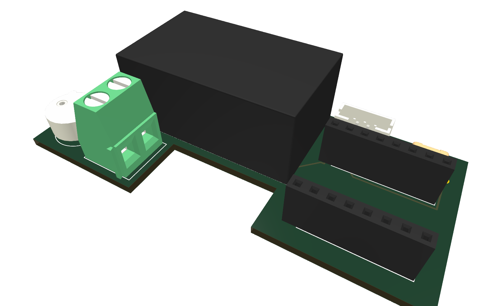
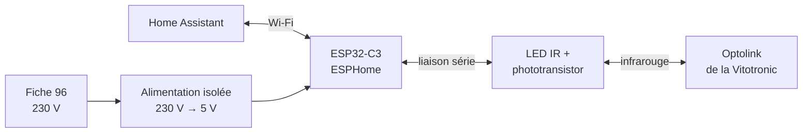
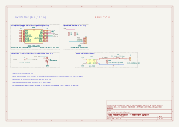
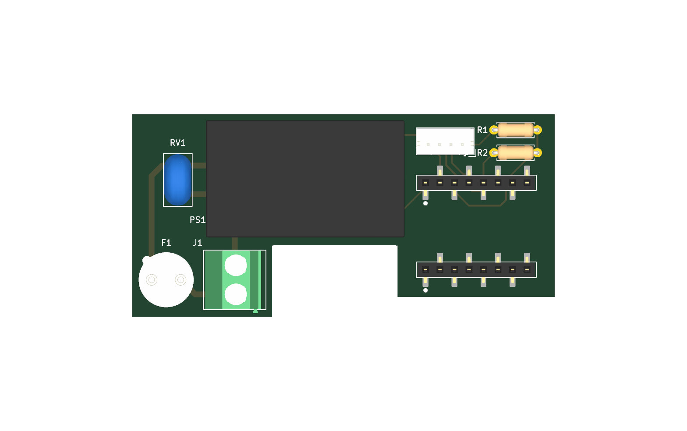
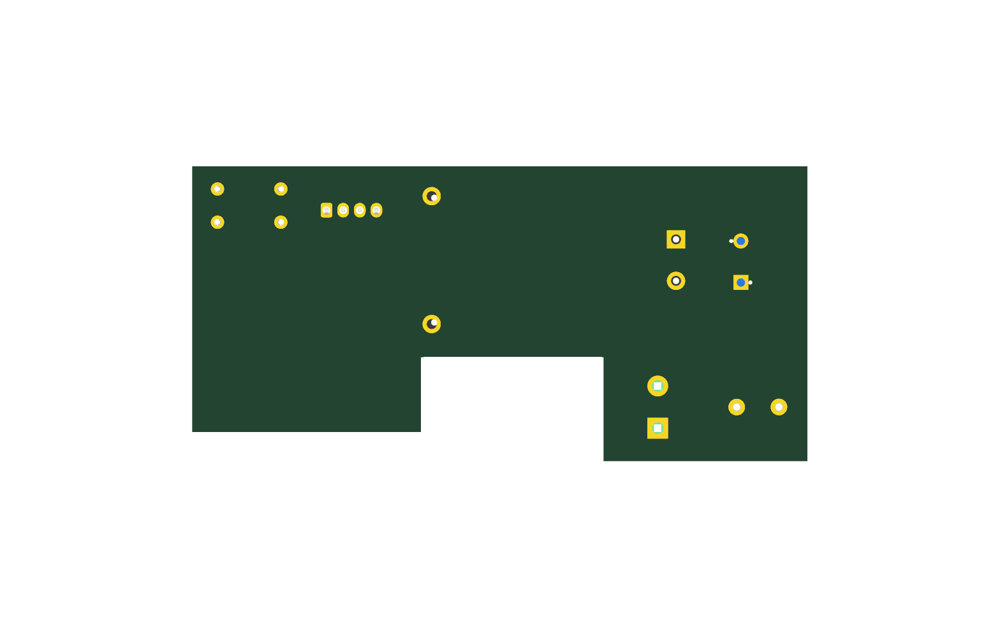

# viessmann-optolink-esphome

**Français** · [English](README.en.md)

Pilotez votre chaudière Viessmann depuis Home Assistant, grâce à une petite carte Wi-Fi qui se pose sur son port optique de diagnostic.



> [!NOTE]
> **État du projet.** Le firmware fonctionne sur la chaudière avec un prototype sur plaque d'essai. La carte et le boîtier sont finalisés ; leur version avec l'ESP32-C3 reste à valider sur la chaudière.
>
> **Cartes toutes faites.** J'ai peut-être des cartes montées en stock : ouvrez une *issue* si ça vous intéresse.

## Ce que ça permet

- **Suivre la chaudière** : températures (chaudière, eau chaude, extérieur, fumées), brûleur (marche, puissance, nombre de démarrages, heures de fonctionnement), pompes, défauts.
- **La régler depuis Home Assistant** :
  - consignes d'ambiance (normale et réduite) et d'eau chaude ;
  - mode de fonctionnement (arrêt, eau chaude seule, chauffage et eau chaude) et mode économie ;
  - courbe de chauffe.
- **Sans risque** : si Home Assistant ne répond plus pendant 30 minutes, la chaudière reprend son propre programme.

## Compatibilité

Testé sur une **Vitodens 222-W** avec régulation **Vitotronic 200 type HO1B**. Les autres chaudières Viessmann qui ont un port Optolink devraient fonctionner, en adaptant les adresses de la configuration. Les modèles sont listés sur le [wiki OpenV](https://github.com/openv/openv/wiki).

## Comment ça marche

Les régulations Viessmann ont en façade un port optique, l'Optolink, prévu pour les outils de diagnostic. Une LED infrarouge et un phototransistor, posés dessus, dialoguent avec la régulation. Un ESP32-C3 sous ESPHome relaie ces échanges vers Home Assistant en Wi-Fi. La carte s'alimente sur la sortie 230 V réservée aux accessoires de la chaudière.



## D'où ça vient

Le projet part du composant ESPHome `optolink` de [j0ta29](https://github.com/j0ta29) ([PR #4453](https://github.com/esphome/esphome/pull/4453), fermée par son auteur en octobre 2026 sans être intégrée à ESPHome). Sa page de documentation n'est plus en ligne. Une copie tirée de [Web Archive](https://web.archive.org/web/20251012034933/https://deploy-preview-2737--esphome.netlify.app/components/optolink) est rangée dans `knowledge/viessmann-optolink-esphome.pdf` : on y trouve le schéma d'origine de l'adaptateur infrarouge et sa configuration ESPHome.

Le firmware utilise aujourd'hui [esphome_vitohome](https://github.com/SoulSolistice/esphome_vitohome) de SoulSolistice, un composant ESPHome maintenu qui parle le même protocole et a été mis au point sur la même régulation.

Ce dépôt y ajoute une carte dédiée, avec son alimentation 230 V, et un boîtier qui se fixe sur l'Optolink.

## Le matériel

### Alimentation 230 V

La carte se branche sur la **fiche 96** de la Vitotronic, la sortie 230 V prévue pour les accessoires. Elle est commandée par l'interrupteur de la chaudière : la carte s'éteint avec elle.

- **Alimentation isolée** HLK-PM01 (230 V → 5 V, 3 W) : la partie basse tension est séparée du secteur.
- **Fusible T1A** temporisé, sur porte-fusible, et **varistance** contre les surtensions.
- **Bornier à vis** pour les fils L et N (0,75 mm² souple, avec embouts).
- Plus de **6 mm** entre le 230 V et la basse tension sur la carte.

> [!WARNING]
> Ce montage touche au 230 V de la chaudière. Couper le courant avant toute intervention, et ne jamais brancher l'USB du C3 quand la carte est sous tension : sa broche 5 V est reliée directement à l'USB et alimenterait l'ordinateur. En cas de doute, faites appel à un électricien.

### Schéma



### Carte

Circuit 2 couches de 74 × 35,5 mm, tout en composants traversants. Le C3 est enfiché sur des barrettes, et la tête infrarouge se raccorde par un câble JST : tout se démonte.

| Dessus | Dessous |
|---|---|
|  |  |

Le projet KiCad 10 est dans `hardware/`, consultable en ligne sur [KiCanvas](https://kicanvas.org/?github=https://github.com/Plokkke/viessmann-optolink-esphome/blob/main/hardware/heater-controller.kicad_sch).

### Boîtier

Imprimé en 3D en quatre pièces : deux demi-coques, un couvercle coulissant et la fiche qui se clipse sur l'Optolink. Les fichiers sont dans `enclosure/` : un STL par pièce, `print-setup.stl` avec les quatre pièces sur le plateau, et la source Fusion 360.

## Fabriquer la carte

Deux façons, avec les mêmes fichiers Gerber :

- **La souder soi-même** : JLCPCB fabrique le circuit, LCSC fournit les pièces.
- **La faire monter par JLCPCB** : il soude tout, il ne reste qu'à clipser le fusible.

`hardware/scripts/export.sh` produit dans `hardware/fabrication/` les Gerbers, le panier LCSC et les fichiers d'assemblage JLCPCB (BOM et CPL). Il faut KiCad 10.

**Prix de revient** (devis de novembre 2026) : pour 5 cartes, environ 60 $ de fabrication et de montage chez JLCPCB, plus environ 15 € de fusibles et de câbles, vendus par lots. L'impression du boîtier est négligeable (environ 1 € en fablab). Cela fait **14 à 17 € par carte**, mais **environ 70 €** pour une seule carte si l'on n'a pas déjà les pièces.

### Pièces pour une carte

| Pièce | Qté | Référence | Prix unitaire |
|---|---|---|---|
| Alimentation Hi-Link HLK-PM01 | 1 | LCSC C209903 | 2,74 $ |
| Porte-fusible TR5 Littelfuse 56000001009 | 1 | LCSC C142909 | 0,76 $ |
| Fusible TR5 T1A 250 V temporisé Littelfuse 37211000001 | 1 | LCSC C142808, DigiKey WK4248CT-ND | 0,22 $ (LCSC), 1,24 $ (DigiKey) |
| Varistance Bourns MOV-07D431K | 1 | LCSC C1528105 | 0,14 $ |
| Bornier à vis Kefa KF128 2 points, pas de 5,08 mm | 1 | LCSC C474952 | 0,19 $ |
| Embase JST PH 4 broches B4B-PH-K-S | 1 | LCSC C131334 | 0,05 $ |
| Barrette femelle 1×8, pas de 2,54 mm, 8,5 mm de haut | 2 | LCSC C27438 | — |
| Résistance 220 Ω 1/4 W | 1 | LCSC C57439 | — |
| Résistance 10 kΩ 1/4 W | 1 | LCSC C57436 | — |
| ESP32-C3 super mini, avec ses broches mâles | 1 | AliExpress | — |
| Câble JST PH 4 fils de 200 mm (Adafruit 4045) | 1 | DigiKey 1528-2825-ND | 0,95 $ |
| LED infrarouge 3 mm Everlight SIR204C | 1 | DigiKey 1080-1171-ND | 0,64 $ |
| Phototransistor 3 mm OSRAM SFH 309 FA | 1 | DigiKey 475-SFH309FA-ND | 0,55 $ |

Prix relevés en octobre et novembre 2026, à l'unité ou par petits lots.

## Installer

1. **Flasher le C3** par USB, hors de la carte (voir *Firmware*), puis l'enficher sur ses barrettes.
2. **Préparer la tête infrarouge** : souder la LED et le phototransistor au bout du câble JST, puis les enfoncer dans les trous de la fiche du boîtier. Sur J2 :
   - broche 1 : anode de la LED ;
   - broche 2 : cathode de la LED ;
   - broche 3 : collecteur du phototransistor ;
   - broche 4 : émetteur du phototransistor.

   Ne pas se fier aux couleurs du câble : repérer la broche 1 sur le connecteur.
3. **Câbler le 230 V**, chaudière coupée : les fils de la fiche 96 entrent par la fiche optique et se vissent sur le bornier (borne 1 : L, borne 2 : N).
4. **Fermer le boîtier** et le clipser sur l'Optolink, la LED en face du phototransistor de la chaudière (repère « V » de l'Optolink).
5. **Rallumer la chaudière** : la carte apparaît dans Home Assistant.

Pour vérifier que la LED émet, la regarder à travers l'appareil photo d'un téléphone.

## Firmware

Le firmware est une configuration ESPHome, dans `firmware/`.

```sh
uv tool install esphome
cp firmware/secrets.example.yaml firmware/secrets.yaml   # Wi-Fi, clé API, mot de passe OTA
cd firmware
esphome run controlleur-chaudiere.yaml --device /dev/cu.usbmodemXXXX    # premier flash, C3 en USB
esphome run controlleur-chaudiere.yaml --device controlleur-chaudiere.local   # mises à jour par Wi-Fi
```

Si le C3 n'apparaît pas en USB, le brancher en maintenant son bouton `BOOT`. `test-connectivity.yaml` remplace la chaudière par des entités factices, pour tester le Wi-Fi et Home Assistant sur table.

## Dans Home Assistant

La carte apparaît comme l'appareil **Controlleur chaudière**. Les principales entités :

| Entité | Usage |
|---|---|
| Boiler Temperature, Hot water temperature, Outdoor temperature | températures |
| Burner, Burner power, Burner starts, Burner hours | état et usage du brûleur |
| Disturbance, Last error | défaut en cours, dernière erreur avec sa date |
| Heating | thermostat : consigne d'ambiance et mode, en préréglages |
| Reduced room temperature setpoint | consigne d'ambiance réduite |
| Hot water setpoint | consigne d'eau chaude |
| Operation mode, Economy mode | mode de fonctionnement |
| Heating curve slope, Heating curve level | courbe de chauffe |

> [!IMPORTANT]
> La chaudière garde ses consignes et ses modes en mémoire EEPROM, qui s'use à chaque écriture. Dans vos automatisations, ne changez une valeur que lorsqu'elle doit vraiment changer : pas plus d'une fois toutes les 15 à 20 minutes, et jamais en boucle.

## Limites connues

- **Composant tiers** : le protocole Optolink n'est pas dans ESPHome ; il vient d'[esphome_vitohome](https://github.com/SoulSolistice/esphome_vitohome), figé sur sa version `v0.6`. Pour le mettre à jour, changer ce tag dans `firmware/controlleur-chaudiere.yaml` et recompiler.
- **Un seul pilote** : un autre thermostat branché sur la chaudière (Tado, Vitotrol…) réimpose sa propre consigne. Il faut le débrancher.
- **Wi-Fi** : l'antenne du C3 super mini est faible sur beaucoup de lots. Vérifier le signal (entité *Wi-Fi signal*) dans la chaufferie.

## Pour aller plus loin

- [`knowledge/architecture.md`](knowledge/architecture.md) : rôle de la carte dans la maison, règles d'écriture, choix de conception.
- [`knowledge/datapoints-optolink.md`](knowledge/datapoints-optolink.md) : adresses Optolink de la Vitotronic 200 HO1B.
- [`knowledge/pression-circuit-chauffage.md`](knowledge/pression-circuit-chauffage.md) : pression du circuit de chauffage.
- `knowledge/manuals/` : notices Viessmann.

## Licence

[MIT](LICENSE) : carte, boîtier et firmware sont libres de reproduction, de modification et de commercialisation.

---

**Mots-clés** : Viessmann Vitodens 222-W, Vitotronic 200 HO1B, chaudière gaz, Optolink, interface optique, adaptateur IR, Device ID `20CB`, protocole P300 / VS2, OpenV, vcontrold, ESPHome, Home Assistant, domotique, ESP32-C3, ESP32-C3 super mini, HLK-PM01, circuit imprimé KiCad, JLCPCB, boîtier imprimé en 3D, remplacement du thermostat Tado.
