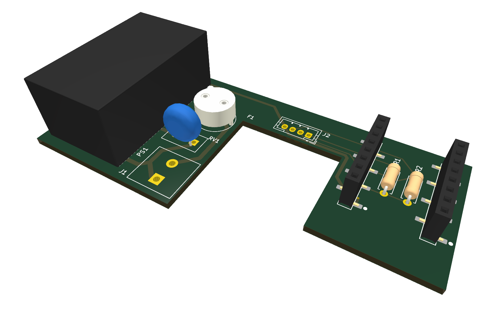

# viessmann-optolink-esphome

**Français** · [English](README.en.md)

Adaptateur DIY qui pilote la chaudière Viessmann **Vitodens 222-W** (murale, ballon intégré ; régulation Vitotronic 200 type HO1B, Device ID Optolink `20CB`) depuis Home Assistant par l'interface optique **Optolink**, en lisant et en écrivant ses *datapoints* (température de chaudière, consigne d'ambiance, mode de fonctionnement, mode économie, défaut).

Firmware ESPHome sur un ESP32-C3 super mini ; protocole `P300` ; composant `optolink` de la PR ESPHome [#4453](https://github.com/esphome/esphome/pull/4453).

> [!NOTE]
> **État du projet.** Le montage (adaptateur IR sur plaque d'essai) et le firmware **fonctionnent sur la chaudière** : lecture des températures et écriture de la consigne et du mode validées, sur un Wemos D1 mini. **DÉCIDÉ** : passage à l'ESP32-C3 super mini (plus compact, UART dédié à l'Optolink, logs par USB) ; le schéma et le firmware sont portés, le portage reste **à valider sur la chaudière**. Le **circuit imprimé** (`hardware/`) est redessiné autour du C3 (carte en U, tout démontable, tête optique déportée) et routé ; il est **prêt à commander** après les vérifications listées plus bas, et le **boîtier** est redessiné à ses dimensions.

**Mots-clés** : Viessmann Vitodens 222-W, Vitotronic 200 HO1B, chaudière gaz, Optolink, interface optique, adaptateur IR, Device ID `20CB`, protocole P300 / VS2, OpenV, vcontrold, ESPHome, Home Assistant, domotique, ESP32-C3, ESP32-C3 super mini, HLK-PM01, remplacement du thermostat Tado.

## Arborescence

| Dossier | Contenu |
|---|---|
| `firmware/` | configuration ESPHome : `common.yaml` (Wi-Fi, API, OTA, LED, diagnostic), `controlleur-chaudiere.yaml` (Optolink), `test-connectivity.yaml` (entités factices), `secrets.example.yaml` |
| `hardware/` | carte dédiée KiCad : schéma (`heater-controller.kicad_sch`, rendu `.svg`), circuit imprimé (`.kicad_pcb`, rendus `-top.png` / `-bottom.png` / `-3d.png`), modèle 3D `heater-controller.step` pour le boîtier (Fusion 360), symbole du C3 super mini (`heater-controller.kicad_sym`), empreintes du projet (`heater-controller.pretty/`, produites par `footprints.py`), règles d'isolement (`.kicad_dru`), fichiers de fabrication (`export-fabrication.sh`) |
| `enclosure/` | boîtier imprimé en 3D, fixé sur le port Optolink, dimensionné pour la carte en U : deux demi-coques (`heater-enclosure-left-shell.stl`, `-right-shell.stl`) qui s'emboîtent, le couvercle (`-lid.stl`) et la fiche qui se clipse sur l'Optolink (`-optical-plug.stl`) |
| `knowledge/` | `architecture.md` (rôles, contrat avec la régulation, sécurité), `datapoints-optolink.md`, `pression-circuit-chauffage.md`, notices Viessmann (`manuals/`), doc du composant optolink, photos |

## Matériel

| Composant | Rôle |
|---|---|
| ESP32-C3 super mini | Wi-Fi + UART vers l'Optolink (GPIO4/GPIO3), logs par l'USB natif |
| LED IR (ex. SIR 204 EVL) + 220 Ω | émission vers la chaudière |
| Phototransistor (ex. SFH 309 FA) + 10 kΩ | réception |

Câblage (cf. `knowledge/viessmann-optolink-esphome.pdf`, p. 2) :

| C3 super mini | Branché sur |
|---|---|
| `3V3` | résistance 220 Ω → anode de la LED IR ; résistance 10 kΩ → collecteur du phototransistor |
| `GPIO4` (TX) | cathode de la LED IR |
| `GPIO3` (RX) | collecteur du phototransistor |
| `GND` | émetteur du phototransistor |

La LED IR est alignée sur le phototransistor de la chaudière et inversement (repère « V » de l'Optolink). Un repère au scotch indique, sur l'adaptateur, le côté `TX` (LED IR) et le côté `RX` (phototransistor), pour le monter dans le bon sens.

## Carte dédiée (`hardware/`)


Ouvrir `hardware/heater-controller.kicad_pro` dans KiCad 10, ou en ligne sur [KiCanvas](https://kicanvas.org/?github=https://github.com/Plokkke/viessmann-optolink-esphome/blob/main/hardware/heater-controller.kicad_sch). La carte (86 × 39,5 mm, 2 couches) se place **parallèle à la façade de la chaudière**, dans la partie élargie du boîtier, et flotte (pas de fixation). Elle a la forme d'un **U renversé** : le 230 V sur la jambe gauche, la fiche de la tête optique sur la barre, le C3 sur la jambe droite. L'encoche entre les jambes (24,5 mm) sépare le 230 V de la basse tension et laisse passer le câble 230 V jusqu'au bornier. **Tout est démontable** : C3 sur barrettes, tête optique sur une fiche, 230 V sur bornier, fusible sur porte-fusible.

| Réf. | Composant | Empreinte | Place |
|---|---|---|---|
| PS1 | HLK-PM01 (230 V → 5 V, 3 W) | `Converter_ACDC_HLK-PM01`, d'après la fiche Hi-Link (34 × 20 × 15 mm) | jambe gauche, debout : broches 230 V en bas, broches 5 V en haut vers la barre |
| F1 | fusible T1A (valeur conseillée par Hi-Link) | porte-fusible TR5, pas de 5,08 mm, trous de 1,0 mm | jambe gauche, en haut à droite |
| RV1 | varistance Bourns MOV-07D431K (275 V AC) | `RV_Disc_D9mm_W4.8mm_P5mm_Inline` : pattes alignées au pas de 5 mm, trous de 1,0 mm, disque de 9 × 4,8 mm | jambe gauche, au milieu, entre le fusible et le HLK |
| J1 | bornier à vis 2 points, fils L et N de la fiche **96** (jusqu'à 1,5 mm² avec embout) | `TerminalBlock_Kefa_KF128-5.08_1x02` : Kefa KF128, pas de 5,08 mm, trous de 1,4 mm, 10,16 × 10,7 × 14,1 mm | jambe gauche, en bas, ouvert vers l'encoche |
| J2 | fiche de la tête optique : `GND` `RX` `TX` `LED+` | JST PH 4 broches vertical (B4B-PH-K-S), pas de 2 mm, trous agrandis à 0,9 mm | barre du U ; nappe JST PH 4 fils vers D1 et Q1 soudées au bout |
| J3, J4 | barrettes femelles du C3 (broches 1–8 et 9–16) | `PinSocket_1x08_P2.54mm_SMD_HX-ZQ` : barrette CMS 1×8 hanxia (LCSC C48641756), pattes en quinconce | jambe droite, à 15,24 mm d'entraxe ; C3 antenne contre le bord haut, USB vers le bas |
| R1 | 220 Ω, courant de la LED IR | axiale, pas de 7,62 mm | entre les barrettes, sous le C3 |
| R2 | 10 kΩ, tirage du phototransistor | axiale, pas de 7,62 mm | entre les barrettes, sous le C3 |

D1 (LED IR) et Q1 (phototransistor) sont **hors carte** : enfoncés dans les trous de 3 mm de la fiche (axes à 14,0 mm), reliés à J2 par la nappe. Le C3 (MOD1) n'est pas soudé : sur le schéma, il est branché par J3 et J4 ; sur la carte, un contour sans pastilles montre sa place et interdit le cuivre sous l'antenne.

Les empreintes du projet sont produites par `hardware/footprints.py`, à partir des fiches techniques des pièces. L'entraxe des rangées du C3, 15,24 mm (0,6″, module compatible plaque d'essai), vient de [ProtoSupplies](https://protosupplies.com/product/esp32c3-supermini/). Les broches 1–8 `5V GND 3V3 GPIO4…0` sont d'un côté, les broches 9–16 `GPIO5…10 GPIO20 GPIO21` de l'autre ; la première broche est à 1,27 mm du bord USB.

Routage :

- **230 V** : pistes de 1 mm, toutes sur la face avant. La varistance est placée en tête : la phase va du fusible à la varistance, puis de la varistance au HLK.
- **5 V et GND** : pistes de 0,7 mm le long du bord haut, le +5V en face arrière, le GND en face avant. Le GND passe sous J2 puis longe l'encoche jusqu'au C3.
- **Signaux** : pistes de 0,3 mm ; RX passe au-dessus de J2.
- **Pas de plan de masse** (**DÉCIDÉ**) : avec un UART à 4800 bauds et un C3 qui a son propre plan de masse, des pistes de 0,7 mm suffisent, et aucun cuivre ne risque de passer sous l'antenne.

Les règles DRC imposent ≥ 6 mm entre le 230 V et la basse tension et ≥ 2,5 mm entre conducteurs 230 V. Seules les deux bornes de J1 y échappent : leur écart est celui, normalisé, du bornier.

| Face avant | Face arrière | Vue 3D |
|---|---|---|
|  |  |  |

Le DRC (`kicad-cli pcb drc --schematic-parity`) ne trouve ni erreur, ni liaison manquante, ni écart avec le schéma. Il reste des avertissements de sérigraphie : des repères coupés par les pastilles, sans conséquence à la fabrication.

### Commander

`hardware/export-fabrication.sh` relance le DRC (il s'arrête s'il trouve une erreur) puis produit, dans `hardware/fabrication/` (non versionné) :

- `heater-controller-gerbers.zip`, à déposer tel quel chez le fabricant ;
- `heater-controller-bom-jlcpcb.csv` et `heater-controller-cpl.csv`, la liste et les positions des pièces assemblées par JLCPCB : seulement les CMS, J3 et J4 ;
- `heater-controller-lcsc-cart.csv`, le panier LCSC des pièces à souder soi-même (plus le fusible), à déposer dans le *BOM Tool* de LCSC ;
- `heater-controller-bom.csv`, la liste complète des composants.

Chaque pièce porte sa référence LCSC dans le schéma (champ `LCSC`) ; `split-bom.py` répartit la liste entre JLCPCB (pièces présentes dans le fichier de placement) et le panier LCSC. Les commandes JLCPCB et LCSC peuvent partir ensemble : expédier la commande JLCPCB vers l'entrepôt LCSC, puis l'ajouter au paiement LCSC.

Le script régénère aussi les rendus, le STEP et le SVG.

Réglages du circuit (JLCPCB) : 2 couches, FR-4 de 1,6 mm, cuivre de 1 oz, HASL sans plomb, 5 exemplaires (le minimum de fabrication). Les coins intérieurs du U seront arrondis par la fraise (rayon d'environ 0,5 mm), sans conséquence.

L'assemblage des barrettes par JLCPCB est **facultatif** : environ 13 $ de plus (mise en route, pochoir, frais de pièce hors catalogue de base), sur 2 cartes minimum. L'entraxe ne dépend pas de qui soude : ce sont les pastilles qui le fixent. Pour les souder soi-même, enficher les deux barrettes sur le C3 avant de les souder : le module les tient alors à son entraxe.

Pièces (stock et prix LCSC relevés le 27/10/2026) ; les empreintes suivent leurs fiches techniques, une autre référence peut ne pas s'y monter :

| Réf. | Pièce | Fournisseur | Prix |
|---|---|---|---|
| PS1 | Hi-Link HLK-PM01, à broches traversantes | LCSC C209903 | 2,74 $ |
| F1 | porte-fusible TR5 Littelfuse 56000001009 | LCSC C142909 | 0,76 $ |
| F1 | fusible TR5 T1A 250 V temporisé Littelfuse 37211000001 (pattes longues, à couper à ~4 mm) | LCSC C142808 | 0,22 $ (par 5) |
| RV1 | varistance Bourns MOV-07D431K | LCSC C1528105 | 0,14 $ (par 5) |
| J1 | bornier à vis Kefa KF128-5.08-2P-AA (250 V, 24 A, jusqu'à 2,5 mm²) | LCSC C474952 | 0,19 $ (par 5) |
| J2 | embase JST B4B-PH-K-S | LCSC C131334 | 0,05 $ (par 10) |
| — | nappe JST PH 4 fils de 200 mm, bouts étamés (Adafruit 4045) | DigiKey 1528-2825-ND | 0,84 € |
| J3, J4 | barrettes femelles CMS 1×8 hanxia HX PM2.54-1x8P TP H8.5-ZQ, posées par JLCPCB (ou à souder soi-même) ; broches mâles à souder sur le C3 | LCSC C48641756 | — |
| R1, R2 | 220 Ω et 10 kΩ, axiales, 1/4 W | stock personnel | — |
| D1, Q1 | LED IR 3 mm (SIR 204 EVL) et phototransistor 3 mm (SFH 309 FA), ceux du prototype | stock personnel | — |

À vérifier avant de commander :

- **l'entraxe du C3** : si le module, broches soudées, s'enfonce dans une plaque d'essai à cheval sur la gorge centrale, l'entraxe de 15,24 mm est le bon ;
- **le HLK-PM01** : l'empreinte suit la fiche Hi-Link (broches 5 V à 15,4 mm l'une de l'autre, à 29,4 mm des broches 230 V), avec des trous de 1,2 mm pour absorber la tolérance de ±8 %. Un module différent, ou à pastilles, ne s'y monte pas ;
- **l'impression à l'échelle 1** de `hardware/heater-controller.svg` : y poser le C3, le HLK et le bornier ;
- **le boîtier** : la carte fait 86 × 39,5 mm. La partie la plus haute est le HLK (15 mm), puis le bornier (14,1 mm) ; le C3 sur barrettes monte à environ 13 mm. Le boîtier offre 86,8 × 40,3 mm à l'intérieur, soit environ 0,4 mm de jeu par côté, et 30,8 mm de profondeur.

Une fois sur la chaudière, le C3 est alimenté en 5 V par le HLK-PM01 : **jamais d'USB branché en même temps**. Sur la plupart des C3 super mini, la broche `5V` est reliée directement au VBUS de l'USB-C : le 5 V externe remonterait dans le port USB de l'ordinateur. Pour vérifier que la LED émet, regarder à travers l'appareil photo d'un téléphone.

## Firmware

### Prérequis

```sh
uv tool install esphome
cp firmware/secrets.example.yaml firmware/secrets.yaml   # puis renseigner les valeurs
```

`secrets.yaml` n'est pas versionné. Si l'appareil est déjà adopté dans Home Assistant, reprendre la clé API et le mot de passe OTA existants : en changer oblige à le réadopter.

### Test de connectivité (sans chaudière)

`test-connectivity.yaml` porte le même nom d'appareil que le firmware réel, mais remplace l'Optolink par des entités factices (température qui oscille, consigne, interrupteur). La LED du module (GPIO8) est pilotable depuis Home Assistant et clignote en cas d'erreur (Wi-Fi ou API perdus).

```sh
cd firmware
esphome run test-connectivity.yaml --device /dev/cu.usbmodemXXXX
```

On repasse ensuite sur `controlleur-chaudiere.yaml` par OTA.

### Premier flash (USB)

Le port USB du C3 est indépendant de l'UART de l'Optolink : l'adaptateur IR peut rester branché, **pas le secteur**.

```sh
cd firmware
esphome run controlleur-chaudiere.yaml --device /dev/cu.usbmodemXXXX
```

`ls /dev/cu.*` liste les ports (USB natif du C3 : aucun pilote). Si le module n'apparaît pas, le brancher en maintenant le bouton `BOOT` (GPIO9).

### Mises à jour (OTA Wi-Fi)

```sh
esphome run controlleur-chaudiere.yaml --device controlleur-chaudiere.local
```

### Logs

Les logs sortent par l'USB natif (`logger.hardware_uart: USB_SERIAL_JTAG`), hors secteur, ou par le Wi-Fi :

```sh
esphome logs controlleur-chaudiere.yaml --device controlleur-chaudiere.local
```

Pour tracer les échanges avec la chaudière : `optolink.logger: true` et `logger.level: DEBUG`.

## Datapoints

Les adresses dépendent du modèle de Vitotronic : liste des appareils et des datapoints sur le [wiki OpenV](https://github.com/openv/openv/wiki) (en allemand). Une valeur lue toutes les 10 s par défaut : régler `update_interval` sur chaque entité, l'interface optique est lente.

| Entité | Adresse | Type |
|---|---|---|
| Boiler Temperature | `0xA309` | capteur, 2 octets, ÷ 100 |
| Disturbance | `0x0A82` | capteur binaire |
| Room Temperature Setpoint | `0x2306` | nombre, 3–37 °C |
| Economy mode | `0x2302` | interrupteur |
| Operation mode | `0x2323` | sélection (arrêt / ECS seule / chauffage + ECS) |

## Points d'attention

- **Composant non officiel** : la PR #4453 a été fermée sans fusion. Elle compile avec ESPHome 2026.10, mais une version future d'ESPHome peut la casser ; dans ce cas, épingler la dernière version d'ESPHome qui fonctionne.
- **Pas d'autre commande d'ambiance** : le thermostat Tado réimposait sa propre consigne quelques secondes après chaque écriture. **DÉCIDÉ** : le Tado est débranché, la consigne est pilotée uniquement par ce contrôleur (vérifié le 2026-10-24 : la consigne de 25 °C n'a plus été écrasée).
- **Redémarrage de la chaudière** : le composant suspend la communication 20 s (`communication_suspension`) quand la chaudière ne répond plus, sinon son démarrage se bloque.
- **Antenne** : l'antenne céramique du C3 super mini est médiocre sur beaucoup de lots ; `wifi.output_power: 8.5dB` stabilise la liaison. Vérifier le signal (`Wi-Fi signal`) dans la chaufferie.
